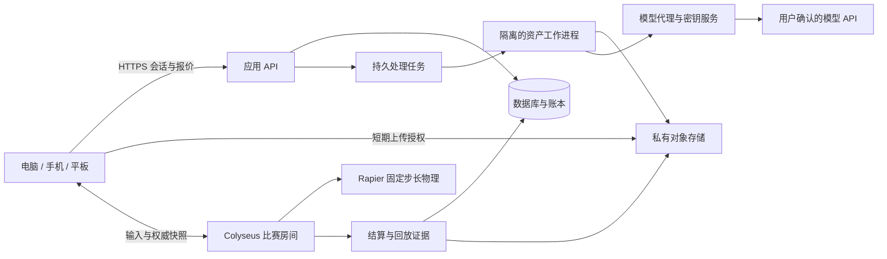

> 历史v0.3：对应底座推台设计，仅供追溯。当前机体设计见 [v0.4](mecha-v0.4/README.md)，不把旧规则和任务当现行方案。

# 系统架构

状态：拟采用架构，尚未部署或测试。实现前锁定依赖版本并验证原生库、WASM 与协议兼容。

## 技术路线

Web 客户端采用 TypeScript、React 和 Three.js；React 管理界面，渲染循环独立。首发直接使用 Three.js，暂不增加 react-three-rapier 的额外版本耦合。Node.js 承载应用 API 与 Colyseus 房间；Rapier WASM 在房间进程执行物理。Python 工作进程执行隔离的网格清洗/重建。PostgreSQL 保存业务状态与费用账本，对象存储保存私有文件，队列由应用的持久任务表或独立队列驱动。

先做一个应用服务、一个房间服务、一个隔离资产工作进程，避免先拆大量服务。GPU 重建可接第三方 API 或独立部署，浏览器不负责重建。

## 深模块的公开边界

| 模块 | 对外能力 | 必须隐藏的复杂性 |
|---|---|---|
| Asset Pipeline | 预检、规范化、查看处理状态、发布 | 文件隔离、单位转换、凸分解、LOD、产物校验 |
| Physics Profile | 确认参数、计算 CP、冻结档案 | 体积有效性、惯量来源、材质预设、规则校验 |
| Model Gateway | 测试能力、报价、提交、查询、撤销 | 协议差异、密钥、网络策略、供应商账单语义 |
| Cost Ledger | 预留、结算、释放、对账 | 幂等、并发余额、未知供应商结果 |
| Match Room | 加入、输入、重连、结算 | 物理步进、输入验证、预测校正、证据记录 |
| Client | 向导、编辑、练习、对战、回放 | 设备适配、资源恢复、画质、触摸与键盘映射 |

## 实时循环

目标：服务器物理 60 Hz，客户端输入最多 30 Hz，快照 20 Hz；画面 30/60 fps 与物理频率解耦。这些是待原型验证的目标。

客户端只提交递增序号和归一化控制值，不提交可信坐标。服务器按接收时间、有效序号与速率接受输入，使用最近有效输入；超过 250 ms 没有输入时油门和转向归零。刹车输入的默认值按规则处理，不让失联无限驱动。

本地玩家可预测、远端插值；首发参战要求锁定的 WASM 解码/预测构建通过自检，无预测参战待单独验证。快照带 lastAppliedSeq、该输入首次生效的 appliedAtTick 与 serverTick；收到但未应用的输入不能被确认，客户端按权威tick和输入持续区间校正，仅重放尚未应用的部分。发生双人碰撞时以服务器为准，不能假定本地全场预测永远正确。过晚输入不回溯改写终局；首发不做全场回滚。

房间超载时不跳过物理步掩盖性能问题；限制追赶步数、停止分配新局，持续超标则作无效局并保留诊断。不得偷偷降低某一局的物理质量。

## 房间与失联

房间状态：forming → loading → countdown → running → finished；错误可到 aborted。所有参赛者的资产与能力检查通过后才倒计时；加载超过 30 秒取消，不能因为较慢设备未加载完就开局。

掉线后继续运行物体和计时，输入按250ms超时归零。每人每局累计失联预算15秒；连接中断或心跳超过2秒未响应时进入失联态，起点回溯到最后有效心跳。重连停止累计但不重置预算，预算内可回原局且期间仍可能出局。预算耗尽、出界和主动退出统一进入同一步lose标记，按物理规则总顺序结算。服务器没有可靠终局且无法继续裁决时为无效局。iOS切后台按潜在失联处理。

## 回放与一致性

保存资产、地图、碰撞代理、物理引擎构建、规则与协议哈希；记录服务器接受的输入及每秒关键状态、20 Hz 轻量位姿帧和终局事件。普通观看使用权威位姿帧，不需要跨版本重新仿真。调查可在相同运行构建中重演输入，对比关键帧哈希。

Rapier 官方资料对普通 JS 构建与确定性构建的描述存在差异；不以“跨平台完全决定论”为产品依赖。必须锁定实际包并测试快照哈希；跨版本或跨构建不承诺逐位相同。存储快照不自动解决作弊、丢帧或服务器丢失问题。

对局结果采用 outbox/事务落库，`matchId` 唯一，重复提交不重复结算。服务器在运行中崩溃且没有完整裁决证据，标记 aborted，不凭客户端结果计算排名；已可靠落库的 finished 结果按 matchId 恢复。

## 文件与网络边界

上传先进入隔离区，按真实文件头、字节数、解压后大小、网格/纹理复杂度检查。工作进程无任意出网、非特权运行，限制 CPU、内存与时间；拒绝外部 URI、脚本、路径穿越、超大纹理和畸形网格。首发不接受 ZIP、多文件外链或主动内容。

原图、原模型与 API 密钥属于用户；对象访问按 ownerId 校验并使用短期签名，不能知道 assetId 就能读取。原图默认不进入公开分享。模型代理需要受约束出网，不能从 API 进程直接请求任意用户 URL。

日志只保留操作 ID、耗时、状态与用量，默认不收集原图、完整提示词、密钥或供应商请求头。备份删除窗口及对局证据保留详见数据模型。
