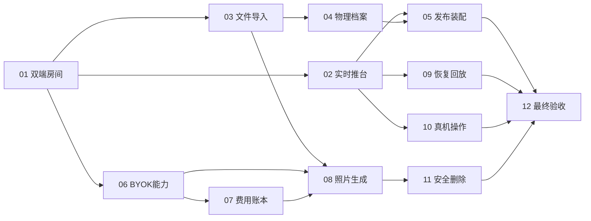

> 历史v0.3：对应底座推台设计，仅供追溯。当前机体设计见 [v0.4](mecha-v0.4/README.md)，不把旧规则和任务当现行方案。

# 开发顺序与阶段门槛

这是按依赖组织的建议顺序，不是工期承诺。没有团队人数、预算或实际基准，因此不编造上线日期。

## 阶段一：证明能玩

任务 01：两端进入私密房间、看见同一个预置物体状态。任务 02：标准底座实时推台、唯一服务器结算。通过后可演示电脑与手机一局，暂不涉及用户图像和真实外部收费。

## 阶段二：证明物体可信

任务 03 导入、任务 04 校准/物理档案、任务 05 发布与装配。用户可亲自带入 GLB/STL，看到外观、代理、质量来源和 CP，并在练习与私密房间使用。复杂形状不合格时明确拒绝。

## 阶段三：证明生成可控

任务 06 BYOK 能力检测、任务 07 费用上限与任务账本、任务 08 照片生成。先用模拟供应商跑失败路径，再接一个真实服务；最终可完成“手机拍照→确认→另一设备参战”。本阶段不自动授权使用真实 API 密钥或产生付费请求。

## 阶段四：证明能稳定交付

任务 09 断线/回放、任务 10 真机控制与性能、任务 11 隔离/删除、任务 12 全链路验收。所有费用、安全和权威判定门槛必须通过。

排位只在 CP、公平性和网络质量已有实测证据后单独立项。原生 App、复杂机械、COLMAP 多视角、破坏和市场不抢占首发闭环。

## 依赖关系

每个任务的可演示行为、实际依赖与失败条件见 [任务目录](../.scratch/object-arena/issues/)。完成标准是运行证据，不是文件写完。
